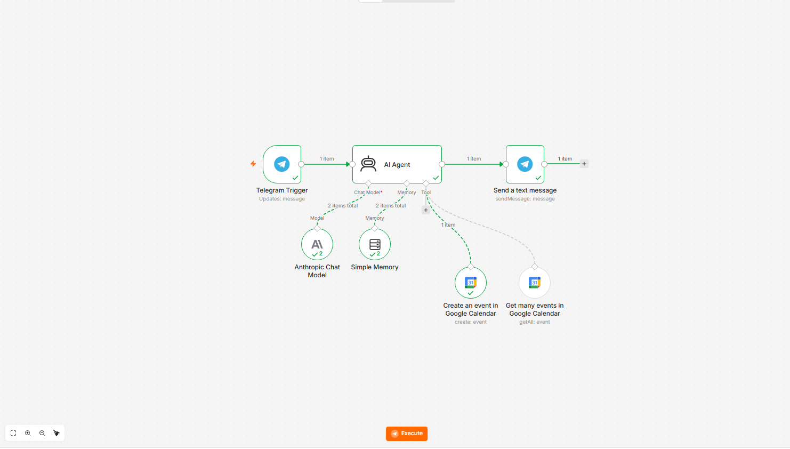
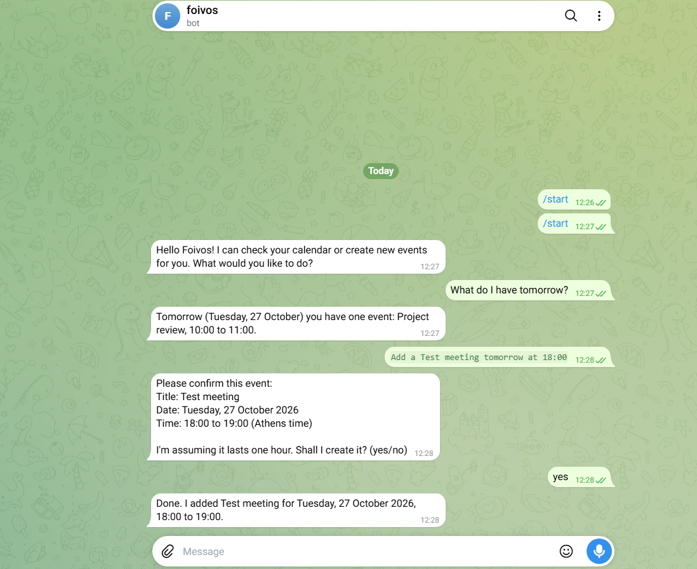

# Telegram AI Assistant (n8n + Claude + Google Calendar)

A Telegram chatbot built with [n8n](https://n8n.io) that understands natural language,
remembers the conversation, and can **read and create events in Google Calendar**.
Before it changes anything, it asks the user to confirm.

> Example: *"What do I have tomorrow?"* → the bot checks the calendar and answers.
> *"Add a dentist appointment tomorrow at 18:00"* → the bot repeats the details, waits for "yes", then creates the event.




## How it works

```
Telegram Trigger -> AI Agent -> Send a text message
                     |-- Anthropic Chat Model   (the "brain": Claude)
                     |-- Simple Memory          (remembers the last messages per chat)
                     |-- Google Calendar tools  (get many events, create event)
```

- **Telegram Trigger** receives each user message through a webhook.
- **AI Agent** decides on its own whether it needs a tool. A question like
  "What do I have tomorrow?" calls the Calendar tool; a general question does not.
- **Simple Memory** uses the Telegram chat id as the session key, so every user has a separate memory.
- **Send a text message** replies in the same chat. The chat id is read from the Telegram Trigger node.
- The current date and time are added to the user message so the AI can understand "tomorrow" or "next Friday".
- A system message tells the AI to reply in the user's language, in plain text, and to ask for confirmation before creating or changing events.

## Requirements

- [Node.js](https://nodejs.org) (to run n8n locally)
- A Telegram bot token from [@BotFather](https://t.me/BotFather)
- An [Anthropic API key](https://console.anthropic.com) (prepaid credits, pay per use)
- A Google Cloud project with the Calendar API enabled and an OAuth client
- A public HTTPS address for the Telegram webhook (for local use: a free
  [Cloudflare quick tunnel](https://developers.cloudflare.com/cloudflare-one/networks/connectors/cloudflare-tunnel/))

## Setup

1. Start the tunnel: `cloudflared tunnel --url http://localhost:5678` and copy the `https://...trycloudflare.com` address.
2. Start n8n with that address (PowerShell):
   ```powershell
   $env:WEBHOOK_URL="https://YOUR-ADDRESS.trycloudflare.com/"
   npx n8n
   ```
3. Open `http://localhost:5678` and import `workflow.json` (Workflows -> Import from file).
4. Create the credentials in n8n: Telegram, Anthropic, Google Calendar OAuth2.
   The workflow file contains **no secrets**; you connect your own accounts.
   After importing, open the two Google Calendar nodes and select your own calendar (the file contains a placeholder).
5. The Anthropic Chat Model node uses **Claude Haiku 5.5 with Thinking Mode set to `disabled`** (see Known issues for why).
   Set the workflow **Timezone** (workflow Settings) to your own time zone; the file uses `Europe/Athens`.
   Your Google Calendar's own time zone (Calendar Settings) must be the same, otherwise event times look one hour off.
6. Click *Execute workflow* and write to your bot.

## Known limitations

- The tunnel address changes every time it is restarted, so the webhook must be refreshed.
- The workflow runs in test mode (one click per message). Running it permanently needs *Publish* and a stable public address.
- Simple Memory lives in RAM and is cleared when n8n restarts.
- While the Google OAuth app is in *Testing* mode, the Google connection expires every 7 days.
- Early versions of the agent sometimes answered about the calendar from the chat memory instead of calling the tool, or said an event was created when it was not. Strict system-message rules fixed this: "always call the get-events tool first" and "never say an event was created unless the tool succeeded".
- With thinking enabled (for example Claude Sonnet 5.5, which does not allow turning it off), the second question after a tool call failed with an `invalid signature in thinking block` error, because the model's thinking notes are stored in memory and rejected when replayed. The workflow therefore uses Haiku 5.5 with Thinking Mode `disabled`. Whenever you change the system message, also change the Session ID suffix of the Simple Memory node (for example `-v9` to `-v10`) so the memory starts clean.
- Google Calendar returns event times in the calendar's own time zone. If that zone differs from yours, the bot reports times one hour off even though the event itself is correct.

## What I learned

Webhooks and tunnels, API credentials, n8n expressions, AI agents with tools, OAuth with Google,
and how to debug an automation by reading which node failed and why.
